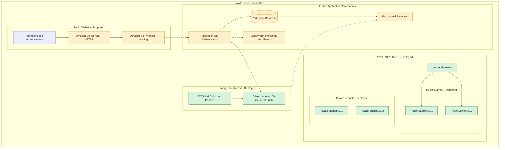

# AWS Training Portal Architecture

## Architecture Diagram

## Diagram Legend

- Green: Infrastructure already deployed through Terraform.
- Yellow: Proposed components not yet deployed.
- Solid arrows: Intended connections or access relationships.
- Dashed arrows: Planned integrations.

## Deployed Infrastructure

- One VPC with CIDR `10.20.0.0/16`.
- Two public subnets and two private subnets.
- Internet Gateway and route tables.
- Private S3 document bucket with encryption and versioning.
- IAM roles and restricted document access policies.

## Proposed Infrastructure

- CloudFront for public HTTPS delivery.
- S3 static website hosting.
- Application and authentication layer.
- Participant database.
- CloudWatch monitoring and alarms.
- Backup and disaster recovery implementation.

**Important:** The proposed components are part of the target architecture, not currently deployed AWS resources.
