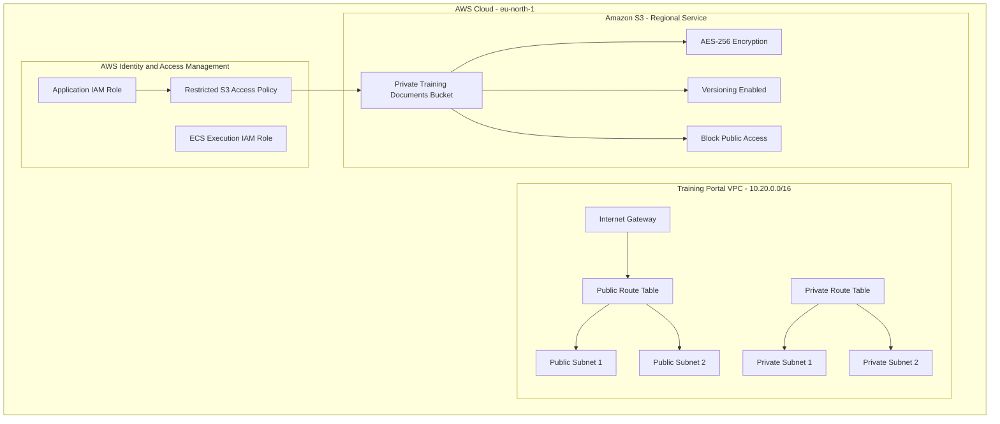

# Training Portal – Actual Deployed Architecture

This diagram shows the AWS resources currently deployed through Terraform.

**Important notes:**
- The private subnets have no NAT Gateway or default internet route.
- The S3 bucket is private, encrypted and versioned.
- The application IAM role and S3 policy exist, but no running application currently uses them.
- The ECS execution role is left over from an earlier experiment.
- A live website, database and monitoring alarms have not yet been deployed.
